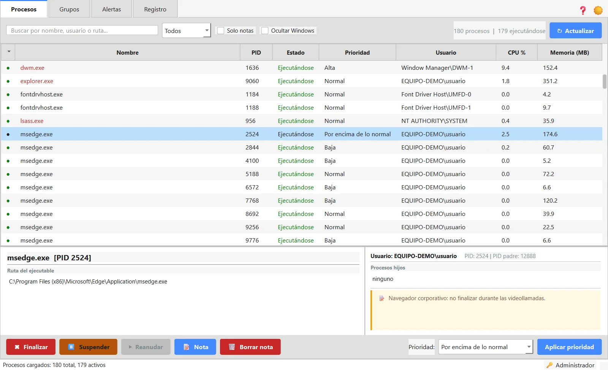
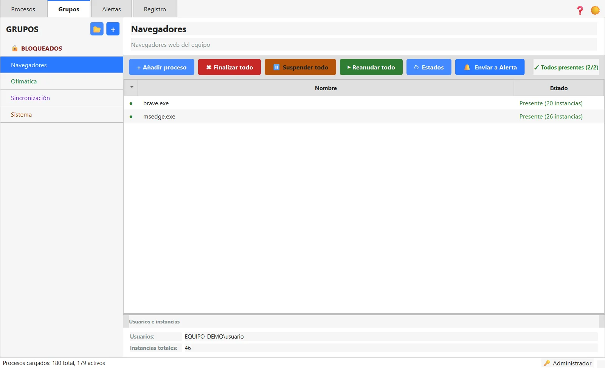
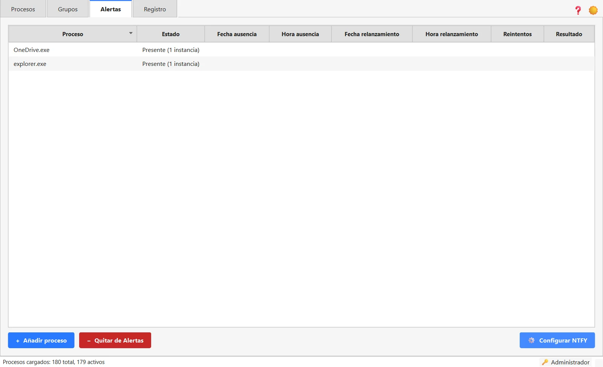
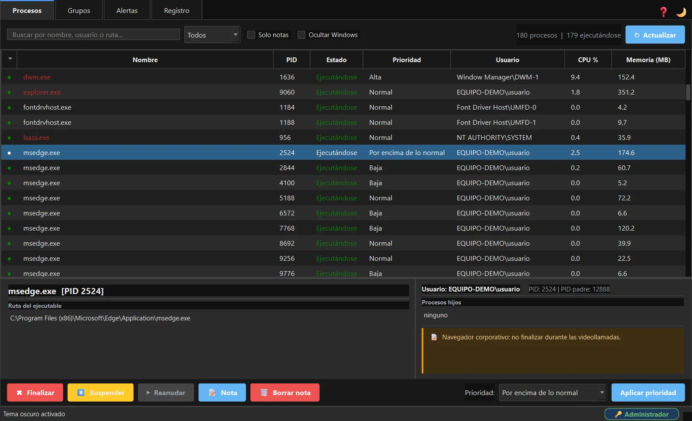

# MAProcess

Gestiona y vigila los procesos de Windows desde una interfaz sencilla: finaliza, suspende, reanuda o cambia la prioridad de cualquier proceso, organízalos en grupos por aplicación y lleva un registro de todas las acciones.

**Software gratuito desarrollado por [Masoft.es](https://masoft.es)**

[](https://github.com/MaSoft/MAProcess/releases/latest)

También puedes descargarlo desde [masoft.es](https://masoft.es/descargas.html).



## Características
- Finalizar, suspender, reanudar y cambiar la prioridad de cualquier proceso.
- Grupos por aplicación: finaliza o reactiva todos sus procesos a la vez; impórtalos y expórtalos en CSV.
- Monitorización automática cada 8 segundos, con aviso si algo cambia.
- Alertas con auto-relanzamiento: si un proceso crítico desaparece, lo intenta relanzar y avisa por NTFY.
- Grupo BLOQUEADOS: impide que un proceso se ejecute, con veto automático a los procesos críticos.
- Búsqueda por nombre, usuario o ruta, notas por proceso y procesos esenciales de Windows en rojo.
- Historial de acciones exportable a CSV, tema claro y oscuro y manual con F1.

## Capturas

| | |
|---|---|
| <br>**Grupos.** Los procesos de una aplicación juntos: finalizar, suspender o reanudar todos a la vez. | <br>**Alertas.** Procesos vigilados: si desaparecen, se relanzan solos y llega un aviso. |
| <br>**Tema oscuro.** Toda la aplicación en tema oscuro, diálogos incluidos. |  |

## Requisitos

| | |
|---|---|
| Sistema | Windows 10 o Windows 11 de 64 bits |
| Permisos | Administrador local, para actuar sobre procesos de otros usuarios o del sistema |
| Instalación | No hace falta: un solo .exe que se copia y se abre. Python va dentro |
| Espacio | 36 MB el programa; la base de datos y el registro se crean junto a él |
| Internet | No hace falta; solo para los avisos NTFY, si se activan |

Al abrirlo propone reiniciarse como administrador. El primer arranque tarda unos segundos.

## Descarga y comprobación

En [Releases](https://github.com/MaSoft/MAProcess/releases/latest) están el programa (`MAProcess_v1.1.1.exe`), su huella SHA-256 y el manual. Para comprobar que la descarga está completa, en PowerShell:

```powershell
Get-FileHash .\MAProcess_v1.1.1.exe
```

Debe coincidir con `9c71467d38b96fcc6669cf0df74960a1b63b4600c3069be9aa390dafd624be2d`.

## Manual

[manual_MAProcess_portable.html](https://github.com/MaSoft/MAProcess/releases/latest/download/manual_MAProcess_portable.html): descárgalo y ábrelo en el navegador.

## Aviso legal

MAProcess es gratuito y se entrega tal cual, sin garantía de ningún tipo. Al descargarlo y usarlo aceptas el aviso legal y las limitaciones de su manual.

> ⚠ Herramienta de uso interno para personal técnico. MAProcess es una herramienta diseñada para técnicos y administradores de sistemas. El uso incorrecto puede provocar la finalización de procesos críticos con consecuencias graves para la estabilidad del equipo o la continuidad del negocio.

**Limitaciones y exclusión de responsabilidad**
- Esta herramienta se proporciona tal cual, sin garantía de ningún tipo.
- El autor no se hace responsable de pérdidas de datos, interrupciones de servicio o daños derivados de un uso inadecuado.
- La identificación de procesos críticos del sistema operativo es orientativa y no sustituye el criterio del técnico responsable.
- Uso restringido a personal autorizado. No redistribuir sin permiso del autor.

Este repositorio solo contiene el programa compilado y su documentación. © Masoft.es. Todos los derechos reservados.
